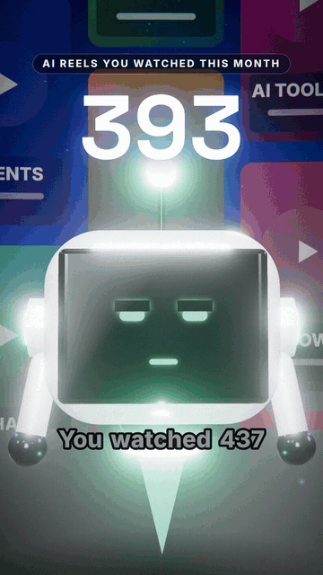
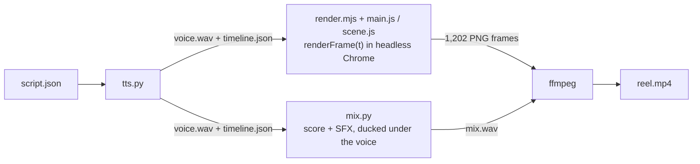

<p align="center">
  
</p>

# build > scroll

> You watched 437 AI reels this month. This is the first one you can `git clone`.

No camera. No editor. No AI video model. Just `renderFrame(t)`, called 1,202 times.

[](LICENSE)
[](https://threejs.org)
[](reels/001-437)
[](reels/001-437)
[](https://www.instagram.com/rithikgour.ai/)

**If you commented SOURCE: hi. The counter just went to 438. You're on the build side now.** 🤖

## What this is

A 40-second Instagram reel where every frame is drawn by code. The 3D is three.js, rendered
frame by frame in headless Chrome and encoded with ffmpeg. The voice is a local open-source
TTS model; the music and sound effects are synthesised in Python. Nothing filmed, nothing
generated by an AI video model.

## The reels

| # | Title | What it is | Source |
| --- | --- | --- | --- |
| 001 | 437 | the launch reel | [reels/001-437](reels/001-437) |
| 002 | Nimble | sort an inbox with a local AI model (comment SORT) | [reels/002-nimble](reels/002-nimble) |
| 003 | Indra OCR | folder of PDFs to an AI-ready knowledge base, on CPU (comment PDF) | [reels/003-indra-ocr](reels/003-indra-ocr) |

New reels land here. [Follow on Instagram](https://www.instagram.com/rithikgour.ai/) to catch them.

## The 3 rules of this repo

1. **No face.** (Byte the robot doesn't count.)
2. **No hype.**
3. **If it takes more than 10 minutes to get your first frame, that's a bug.** [Open an issue](https://github.com/Rithik224661/build-not-scroll/issues).

## 10 minutes to your first frame

You need Node.js 22.12+ and git. That's it for this part.

1. **Clone** (~30 s)
   ```bash
   git clone https://github.com/Rithik224661/build-not-scroll.git
   ```
2. **Install** (2-3 min; Puppeteer downloads its own Chromium)
   ```bash
   cd build-not-scroll/reels/001-437 && npm install
   ```
3. **Render stills** (seconds to a few minutes, depending on your CPU)
   ```bash
   npm run stills
   ```
   One still per voice line, using the `timeline.json` that's already in the repo.
   No Python, no model download.
4. **Open `stills/`.** That's the reel, frozen at 16 moments. You made that.

### Go further: the whole reel

Needs Python 3.10-3.13 and `ffmpeg` on your PATH.

```bash
pip install -r requirements.txt
./scripts/download-models.sh   # Kokoro TTS model, into assets/
npm run voice                  # voice + timeline.json
npm run render                 # all 1,202 frames
npm run mix                    # music + sound effects + voice
npm run encode                 # -> out/reel.mp4
```

Honest numbers: the full render is slow on a CPU. On a CPU-only machine it took about
80 minutes for the 40 seconds (~4 s per frame). Stills take seconds to a few minutes.
The [reel guide](reels/001-437/README.md) has the details, including why your GPU
doesn't help by default.

## Make it yours

Edit the lines in [`script.json`](reels/001-437/script.json), then re-run
voice → stills → render → mix → encode. One line looks like this:

```json
{ "id": "L03",
  "text": "Zero.",
  "pre": 0.45, "hl": ["Zero."] }
```

Every camera move, caption and sound cue re-times itself from the voice timeline. Want
your own voice instead of the TTS? See [Use your own voice](reels/001-437/README.md#use-your-own-voice).

## How it works



**The one rule:** `renderFrame(t)` may depend only on `t` and constants. No `Math.random`,
no clocks. Same input, same pixels. That's what lets the renderer resume after a crash,
lets stills match the final cut, and keeps the sound locked to the picture.

It's also why, during the "It's code" moment, the reel can show you the real frame
counter: `frame 0898 / 1202`, `renderFrame(29.933)`. Not a graphic. The actual call.

## Easter eggs

For people who scroll this far. Hints, not spoilers:

- During the reveal, the code panels aren't lorem ipsum. Look closer, then look at this repo.
- That frame counter on screen? Pause on it and count.
- Byte winks exactly once. Rule 1 says no face. Byte has an opinion about that.

## FAQ

**Is this AI-generated video?**
No. It's rendered by code. The only AI in it is the TTS voice, and the reel carries
Instagram's AI label for that.

**Can I use this for my own reels?**
Yes. The code is MIT and the fonts are OFL. Credit is appreciated, not required.

**Will it run on Windows / Mac?**
You need Node.js 22.12+, Python 3.10-3.13 and `ffmpeg` on your PATH. The install and
stills steps were tested on Windows 11. On Windows the npm scripts call `python3`; if
that's not on your PATH, run `python tts.py` / `python mix.py` directly.

**Why is the voice robotic-ish?**
It's a free local model. Swap in your own recording: see the
[reel guide](reels/001-437/README.md#use-your-own-voice).

## Follow the builds

One AI agent or automation build per reel, under 10 minutes, code included.
[@rithikgour.ai on Instagram](https://www.instagram.com/rithikgour.ai/).

⭐ Starring this repo counts as building something today. Technically.

## License

[MIT](LICENSE) © 2026 Rithik Gour. Fonts, libraries and the TTS model are covered in
[THIRD_PARTY_NOTICES.md](THIRD_PARTY_NOTICES.md).
